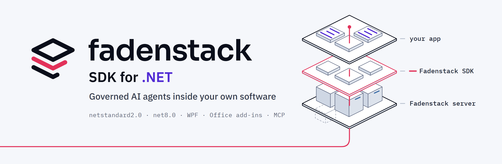

<p align="center">
  <picture>
    <source media="(prefers-color-scheme: dark)" srcset="docs/images/readme/banner-dark.png">
    
  </picture>
</p>

<p align="center">
  <a href="https://www.nuget.org/packages/Fadenstack.Agents"></a>
  <a href="https://github.com/fadenstack/fadenstack-sdk-dotnet/actions/workflows/release.yml"></a>
  
  <a href="https://developers.fadenstack.com/sdk/dotnet/"></a>
  <a href="LICENSE"></a>
</p>

<p align="center">
  <a href="https://developers.fadenstack.com/sdk/dotnet/"><b>Documentation</b></a> ·
  <a href="#an-agent-in-a-host-application"><b>Quick start</b></a> ·
  <a href="docs/samples.md"><b>Samples</b></a> ·
  <a href="https://www.nuget.org/profiles/fadenstack"><b>NuGet</b></a> ·
  <a href="https://fadenstack.com"><b>fadenstack.com</b></a>
</p>

Agents that run inside other software (a desktop application, an Office add-in, a Windows service) and are
governed by a [Fadenstack](https://fadenstack.com) server. The SDK runs the agent loop on the device: host tools, approvals, local
MCP servers and the conversation itself. The server owns the agent's instructions, model and knowledge, and handles
personal data and audit. Agents need a Fadenstack server 0.4.2 or later.

## Highlights

- **The loop runs in your application.** Your own methods become tools with an attribute; the agent asks before
  anything that changes something, and the conversation stays on the device.
- **The server governs.** Instructions, model, knowledge, tool rules, personal data and audit are your
  administrator's, in the Fadenstack console; the app never holds the instructions.
- **A chat panel to drop in.** Platform-neutral view models and a WPF skin, in English, German, French, Spanish and
  Simplified Chinese. The user picks the language, and it follows them to every client.
- **Built for Office and the desktop.** `netstandard2.0` runs in VSTO add-ins on .NET Framework 4.7.2; the gateway
  is a Microsoft.Extensions.AI `IChatClient`; local MCP servers become tools under the agent's policy.

## Packages

| Package | Version | What it is |
|---|---|---|
| [`Fadenstack.Client`](https://www.nuget.org/packages/Fadenstack.Client) | [](https://www.nuget.org/packages/Fadenstack.Client) | The server connection: the gateway as a Microsoft.Extensions.AI `IChatClient`, agent sign-in, the agent's profile, the REST resources, typed errors |
| [`Fadenstack.Agents`](https://www.nuget.org/packages/Fadenstack.Agents) | [](https://www.nuget.org/packages/Fadenstack.Agents) | The agent: the builder, the tool loop, tool classes and modes, approvals, sessions on the device, outcomes, modules and stages |
| [`Fadenstack.Mcp`](https://www.nuget.org/packages/Fadenstack.Mcp) | [](https://www.nuget.org/packages/Fadenstack.Mcp) | Local MCP servers as agent tools, under the agent's local MCP policy |
| [`Fadenstack.Provenance`](https://www.nuget.org/packages/Fadenstack.Provenance) | [](https://www.nuget.org/packages/Fadenstack.Provenance) | Content provenance: what tools place where people read it is marked as AI-generated, signed by the server and recorded |
| [`Fadenstack.UI`](https://www.nuget.org/packages/Fadenstack.UI) | [](https://www.nuget.org/packages/Fadenstack.UI) | Platform-neutral view models for a chat with an agent, with its texts in English, German, French, Spanish and Simplified Chinese |
| [`Fadenstack.UI.Wpf`](https://www.nuget.org/packages/Fadenstack.UI.Wpf) | [](https://www.nuget.org/packages/Fadenstack.UI.Wpf) | The WPF skin for `Fadenstack.UI`: a chat panel for WPF applications and add-ins |

Each package's namespace is its name; `Fadenstack.Client` holds `Fadenstack` and the namespaces under it
(`Fadenstack.Auth`, `Fadenstack.Chat`, `Fadenstack.Tools`, ...). `Fadenstack.Client`,
`Fadenstack.Agents`, `Fadenstack.Mcp`, `Fadenstack.Provenance` and `Fadenstack.UI` target `netstandard2.0` (.NET Framework 4.7.2 and later)
and `net8.0`. `Fadenstack.UI.Wpf` targets `net472` and `net8.0-windows`.


## An agent in a host application

```csharp
using System.ComponentModel;
using Fadenstack;
using Fadenstack.Agents;
using Fadenstack.Tools;

using var client = FadenstackClient.ForAgent(new Uri("https://ai.example.internal"), "my-assistant", out var tokens);
if (!await tokens.IsSignedInAsync())
{
    // First run only: the sign-in is kept for this user on this device (DPAPI on Windows).
    await tokens.SignInAsync(loginToken: args[0], deviceLabel: "Console on " + Environment.MachineName);
}

using var agent = FadenstackAgent.CreateBuilder()
    .UseClient(client)
    .UseAgent("my-assistant")
    .AddTools(new PageTools())
    .Build();

var session = await agent.StartSessionAsync();   // starts in Ask
var result = await session.SendAsync("What is on page 7?");
Console.WriteLine(result.Text);
Console.WriteLine($"Outcome: {result.Outcome}");

public sealed class PageTools
{
    [AgentTool(ToolClass.Read), Description("Reads a page of the open document.")]
    public string ReadPage(int page) => $"Page {page}: section 1.1, table T1.";
}
```

A read tool runs without asking, once the agent's tool contract on the server lists it as `read`; until then it is
unclassified and asks every time. A tool that changes something asks the user first, and without an approval handler
the call is declined. The docs cover [host tools and approvals](docs/tools.md),
[outcomes and errors](docs/outcomes.md), [sessions on the device](docs/sessions.md),
[local MCP servers](docs/local-mcp.md), [the chat panel](docs/chat-panel.md) and [the samples](docs/samples.md).

## Install

```bash
dotnet add package Fadenstack.Agents
```

Each package brings the ones it builds on. Add `Fadenstack.Mcp` for local MCP servers and `Fadenstack.UI.Wpf` for
the WPF chat panel. [Install](docs/index.md#install) also shows how to build from source.

## Build and test

```bash
dotnet test Fadenstack.slnx
```

Build with the .NET 10 SDK. The WPF projects build on any OS (`EnableWindowsTargeting`) and run on Windows only.

To preview the documentation on its own: `pip install zensical`, then `zensical serve` in this folder.

## Contributing

Questions, bug reports and ideas go in [GitHub issues](https://github.com/fadenstack/fadenstack-sdk-dotnet/issues); pick the
template that fits. Please open an issue before you write code for a change, so we can agree on it first.
[CONTRIBUTING.md](CONTRIBUTING.md) says what a pull request needs, including the one-time
[contributor licence agreement](CONTRIBUTOR_LICENSE_AGREEMENT.md) you sign from your first pull request. Everyone
follows the [Code of Conduct](CODE_OF_CONDUCT.md). Report a security problem privately, as [SECURITY.md](SECURITY.md)
describes.

## License

Apache-2.0. See [LICENSE](LICENSE) and [NOTICE](NOTICE). The name and logo are covered by [TRADEMARKS.md](TRADEMARKS.md).
